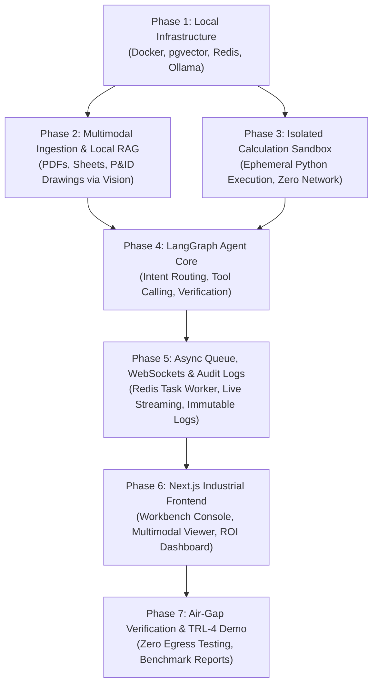

# Master Implementation Plan

## Sovereign On-Premise Knowledge Workbench for Confidential Industrial Operations
**Smart India Hackathon 2026** | **Problem Statement SIH26117**  
**Host Organization:** Mangalore Refinery and Petrochemicals Limited (MRPL)

---

## 1. Overview & Architecture Blueprint

This implementation plan is organized so that **every feature is built on top of tested foundations**. You will not build a user interface before your backend API works, and you will not build an AI agent before your local database and models are ready.



---

## 2. Step-by-Step Implementation Roadmap

### Phase 1: Local Infrastructure & Database Setup
> **Goal:** Get your offline database, task broker, and local AI model server running cleanly.

1. **Update `docker-compose.yml`:**
   - Change PostgreSQL image to `pgvector/pgvector:pg16` so vector search works natively.
   - Keep Redis 7 for async background task handling.
   - Add a private Docker bridge network (`sovereign-net`) with internal routing.
2. **Initialize Database Schema (`init.sql`):**
   - Run `CREATE EXTENSION IF NOT EXISTS vector;`
   - Create tables:
     - `documents`: Stores filename, file hash (SHA-256), classification, and upload date.
     - `document_chunks`: Stores text chunks, embedding vectors (768 dimensions), page numbers, and metadata.
     - `tasks`: Tracks background agent jobs, status (`pending`, `running`, `completed`), and execution timestamps.
     - `audit_logs`: Immutable ledger of queries, model choices, tool executions, and engineer sign-offs.
3. **Pull Local Models via Ollama:**
   - Text & Reasoning: `ollama pull llama3.1:8b`
   - Vision & Schematics: `ollama pull phi3.5-vision`
   - Vector Embeddings: `ollama pull nomic-embed-text`
4. **Verification Step:**
   - Test connecting to PostgreSQL from Python.
   - Test storing and searching a dummy vector.
   - Verify Ollama returns completions via `localhost:11434`.

---

### Phase 2: Multimodal Document Ingestion & Local Vector RAG
> **Goal:** Ingest confidential PDFs, spreadsheets, and engineering drawings into local searchable vectors.

1. **Build Text & PDF Ingestion (`server/ingestion/pdf_parser.py`):**
   - Use `PyMuPDF` (`fitz`) and `pdfplumber` to extract text while keeping track of page numbers and document titles.
   - Segment text into chunks of 500–800 tokens with 100-token overlap.
2. **Build Spreadsheet Ingestion (`server/ingestion/sheet_parser.py`):**
   - Use `pandas` and `openpyxl` to parse `.xlsx` and `.csv` files.
   - Generate natural language summaries of table schemas and column statistics for indexing.
3. **Build P&ID / Drawing Ingestion (`server/ingestion/vision_parser.py`):**
   - Take scanned drawings, crop sections if needed, and prompt `phi3.5-vision` to extract equipment tags, valve IDs, and line codes.
   - Store these tags as structured metadata alongside image thumbnails.
4. **Build Vector Indexing & Search (`server/retrieval/vector_store.py`):**
   - Generate embeddings using `nomic-embed-text` via Ollama.
   - Insert embeddings into PostgreSQL `document_chunks` using `pgvector`.
   - Implement hybrid retrieval: Vector similarity `<=>` combined with metadata filtering (e.g., search only in SOPs or only in P&IDs).
5. **Verification Step:**
   - Upload a sample 5-page refinery SOP PDF.
   - Run a search query (e.g., *"pump lubrication interval"*) and confirm the correct page chunk is returned with high similarity.

---

### Phase 3: Isolated Calculation & Spreadsheet Sandbox
> **Goal:** Provide a secure, offline environment for deterministic mathematical formulas and spreadsheet updates.

1. **Build the Sandbox Runner (`server/sandbox/runner.py`):**
   - Execute Python code inside a restricted subprocess with:
     - **Network:** Completely disabled (blocks any outbound socket connection).
     - **Filesystem:** Read-only access to source spreadsheets; write access limited to a temporary scratch directory.
     - **Resource Limits:** Hard timeout of 10 seconds; memory capped at 512MB.
2. **Build Engineering Formula Tools (`server/sandbox/formulas.py`):**
   - Heat Exchanger duty calculation ($Q = U \cdot A \cdot \Delta T_{lm}$).
   - Pipe flow rate and head loss calculations.
   - Outlier detection and weighted average calculation for plant logs.
3. **Build Spreadsheet Updater (`server/sandbox/excel_tool.py`):**
   - Safely update specific cells in an Excel file without corrupting formatting, and return the modified file path.
4. **Verification Step:**
   - Pass a test math script to the sandbox. Confirm that it executes and returns the correct answer within 1 second.
   - Test a malicious script attempting internet access (`urllib.request`) and confirm it is blocked and raises an error.

---

### Phase 4: LangGraph Multi-Agent Orchestration Core
> **Goal:** Coordinate the multi-step agent workflow: understanding requests, searching documents, calling the sandbox, and verifying answers.

1. **Define Agent State (`server/agent/state.py`):**
   - State holds: `messages`, `task_id`, `intent`, `retrieved_docs`, `sandbox_code`, `sandbox_results`, `verification_passed`, `needs_human_approval`, and `start_time`.
2. **Create Graph Nodes (`server/agent/nodes.py`):**
   - `intent_node`: Uses Llama 3.1 8B to classify user request into:
     - Document search (SOP inquiry)
     - Drawing inspection (P&ID analysis)
     - Calculation / Spreadsheet verification
     - Formal approval note drafting
   - `retrieval_node`: Calls Phase 2 vector search to retrieve relevant chunks.
   - `vision_node`: Calls Phi 3.5 Vision to analyze diagrams if user asked about a drawing.
   - `sandbox_node`: Writes Python code for calculations and executes it inside Phase 3 sandbox.
   - `verifier_node`: Compares calculation outputs against source documents to prevent hallucination.
   - `approval_node`: Pauses graph using LangGraph's `interrupt()` if an action requires an engineer's sign-off.
   - `synthesis_node`: Assembles the final answer with page citations and execution metrics.
3. **Connect StateGraph:**
   - Define conditional edges so the agent only runs the sandbox if math is needed, and only calls vision if a drawing is uploaded.
4. **Verification Step:**
   - Run an end-to-end agent query in terminal: *"Verify the design duty for Heat Exchanger E-101 using the attached sheet."*
   - Confirm the agent retrieves the sheet, runs the formula in the sandbox, and returns a verified result.

---

### Phase 5: Async Task Queue, Streaming WebSockets & Audit Logging
> **Goal:** Run long AI workflows in the background and stream live progress to the frontend.

1. **Setup Redis Task Queue (`server/tasks/worker.py`):**
   - When a user submits a query or upload, the FastAPI endpoint immediately enqueues the job into Redis and returns a `task_id`.
   - A background worker picks up the job and runs the LangGraph agent.
2. **Build WebSocket Streaming Endpoint (`server/api/ws.py`):**
   - Route: `/ws/tasks/{task_id}`.
   - Streams real-time pipeline events to the client:
     - `{"step": "classifying_intent", "message": "Classifying technical request..."}`
     - `{"step": "retrieving", "message": "Retrieved 3 chunks from SOP-402"}`
     - `{"step": "sandbox_running", "message": "Executing formula in secure sandbox..."}`
     - `{"step": "complete", "result": "...", "elapsed_seconds": 18.4}`
3. **Build Immutable Audit Logger (`server/audit/logger.py`):**
   - Records every event into the PostgreSQL `audit_logs` table.
   - Stores user ID, input hash, retrieved chunks, generated code, final response, and exact timestamps.
4. **Verification Step:**
   - Trigger a task via `curl` and connect to the WebSocket endpoint to observe live status updates streaming in real time.

---

### Phase 6: Next.js Industrial Frontend
> **Goal:** Deliver a modern, high-contrast engineering dashboard for refinery engineers.

1. **Dashboard Shell & Navigation (`client/app/`):**
   - Industrial dark/light theme, typography, and clear status indicators (Air-Gapped Status: **ONLINE / ISOLATED**).
2. **Page 1: Workbench Console (`/workbench`):**
   - Left side: Chat interface with file drag-and-drop (PDF, Excel, P&ID images).
   - Right side: **Live Execution Pipeline** visualizing the LangGraph steps in real time as they complete.
3. **Page 2: Multimodal Document Viewer (`/viewer`):**
   - Side-by-side viewer displaying the source PDF or P&ID drawing with cited sections highlighted.
4. **Page 3: Calculation & Sandbox Inspector (`/sandbox`):**
   - Shows the exact Python script executed by the agent, input parameters, calculation results, and download button for updated spreadsheets.
5. **Page 4: Compliance & ROI Metrics (`/compliance`):**
   - Table of immutable audit logs with search and filter.
   - Pending approval queue where engineers can click **Approve** or **Reject**.
   - ROI card: Shows cumulative engineer-hours saved based on the automated processing timer.
6. **Verification Step:**
   - Launch Next.js (`pnpm dev`) and run an end-to-end task from the UI: upload a file, ask a question, watch the steps stream, and download the report.

---

### Phase 7: Air-Gap Verification, Benchmarking & TRL-4 Demo
> **Goal:** Validate air-gapped security and measure turnaround speed improvements for the hackathon jury.

1. **Network Egress Testing:**
   - Run network monitoring (`netstat` or Docker egress inspection) during a heavy agent run to mathematically prove **0 bytes** were sent to external IPs.
2. **Run 3 Benchmark Test Cases:**
   - **Case A: Standard SOP Search & Compliance:** Querying isolation steps across a 40-page refinery manual.
   - **Case B: P&ID Drawing Extraction:** Reading equipment tags and line specs from a complex schematic.
   - **Case C: Spreadsheet Calculation & Approval Draft:** Calculating monthly plant metrics and generating a formal approval note.
3. **Generate ROI Benchmark Report:**
   - Document the comparison: Manual engineer time (~45 mins) vs. Workbench time (~25 seconds) = **~98% reduction in turnaround time**.

---

## 3. Directory Structure After Completion

```text
capstone/
├── client/                     # Next.js 15 Web Gateway
│   ├── app/
│   │   ├── workbench/          # Main engineer workspace & pipeline viewer
│   │   ├── viewer/             # Side-by-side multimodal document viewer
│   │   ├── compliance/         # Audit logs, approval gates & ROI tracker
│   │   ├── layout.tsx          # Industrial shell layout
│   │   └── page.tsx            # Landing & plant overview
│   ├── components/             # Reusable UI components
│   └── package.json
│
├── server/                     # Python 3.11+ Agent Engine
│   ├── agent/                  # LangGraph multi-agent core
│   │   ├── graph.py            # StateGraph definition & routing
│   │   ├── nodes.py            # Intent, retrieval, vision, sandbox & verification nodes
│   │   └── state.py            # Typed agent state
│   ├── ingestion/              # Multimodal parsers (PDF, Excel, P&ID vision)
│   ├── retrieval/              # pgvector search & hybrid retrieval
│   ├── sandbox/                # Isolated Python calculation runner
│   ├── tasks/                  # Redis task worker & async job queue
│   ├── audit/                  # Immutable audit logging & ROI calculator
│   ├── api/                    # FastAPI routes & WebSocket endpoints
│   ├── main.py                 # FastAPI application entrypoint
│   └── requirements.txt        # Python backend dependencies
│
├── docker-compose.yml          # PostgreSQL (pgvector) + Redis container configuration
├── init.sql                    # Database tables and vector extensions
├── FINAL_FEATURES.md           # Complete feature catalog and use cases
├── IMPLEMENTATION_PLAN.md      # This master implementation guide
└── README.md                   # Project overview & quickstart
```
