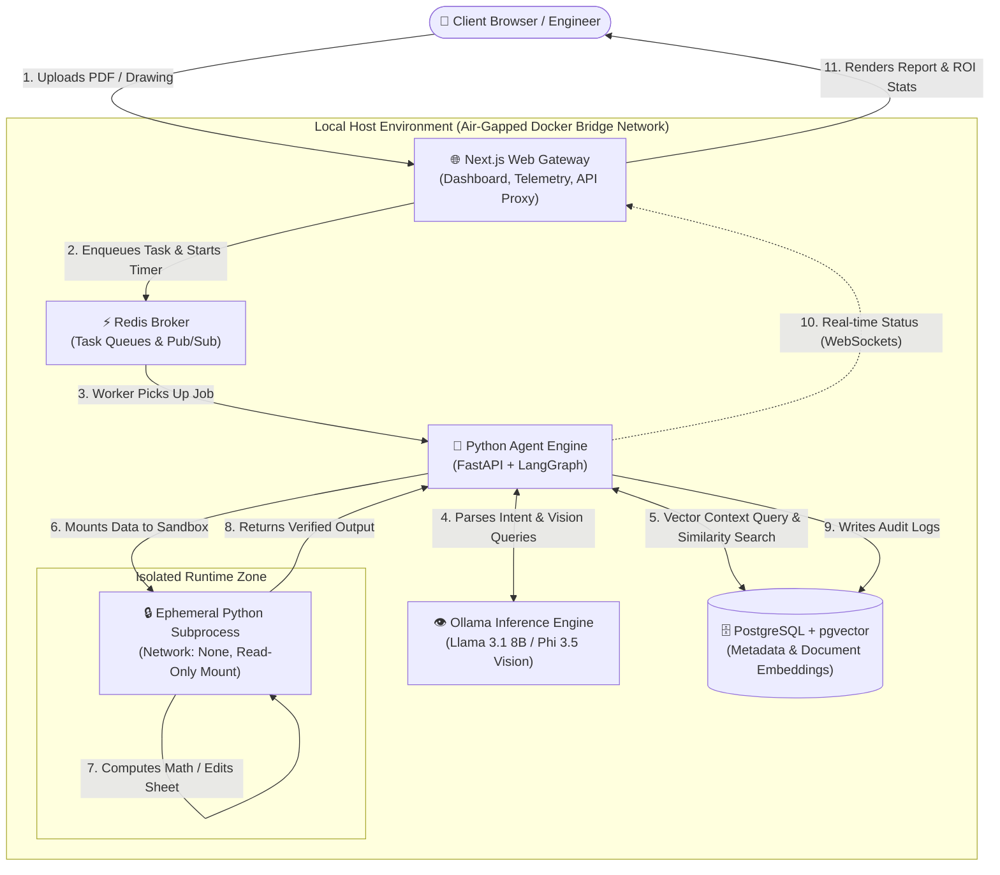

# Sovereign On-Premise Knowledge Workbench for Confidential Industrial Operations

[](https://www.sih.gov.in/)
[-orange.svg)](https://www.mrpl.co.in/)
[]()
[-yellow.svg)]()
[]()

---

## 📌 Project Overview

Industrial organizations such as oil refineries, public sector undertakings (PSUs), and chemical plants handle massive amounts of sensitive data daily:
- Standard Operating Procedures (SOPs)
- Equipment inspection reports
- Plant technical calculations and spreadsheets
- Engineering drawings (P&IDs, schematics)
- Scanned maintenance records

Because this information is strictly **confidential and business-critical**, it **cannot be uploaded to public cloud AI tools** (like ChatGPT or commercial cloud APIs).

**The Sovereign On-Premise Knowledge Workbench** is a fully private, self-contained AI assistant that runs entirely on local company hardware without requiring an internet connection. It automates repetitive, time-consuming tasks—such as parsing thick inspection reports, verifying engineering calculations, extracting diagram data, drafting approval summaries, and updating spreadsheets—while ensuring **100% data sovereignty**.

---

## 🎯 Key Objectives & Features

1. **🔒 100% Air-Gapped & Sovereign**
   - Runs completely offline inside an isolated local network (Docker bridge network).
   - Zero outbound traffic to external AI servers. Built-in network logging proves data never leaves the building.

2. **📄 Multimodal Document Processing**
   - Reads digital and scanned PDFs, spreadsheets, technical papers, and engineering drawings using open-weight vision-language models.

3. **🤖 Intelligent Agentic Workflow**
   - Uses **LangGraph** to break down complex tasks into smaller logical steps.
   - Decides whether to query the local vector database, invoke a vision model, or run a calculation tool.

4. **🧮 Isolated Math & Code Sandbox**
   - Executes Python calculations and spreadsheet edits inside an ephemeral, network-isolated container (`Network: None`) with read-only mounts for maximum security.

5. **✅ Source Verification & Audit Trail**
   - Every answer is cross-checked against source document references (page numbers, section titles) to prevent hallucinations.
   - Retains human-in-the-loop approval before finalizing critical operational decisions.

6. **⏱️ Built-in ROI & Productivity Timer**
   - Automatically tracks how long each automated task takes compared to manual human effort, demonstrating measurable time and cost savings.

---

## 🏛️ System Architecture

The following diagram illustrates how an engineer's request flows securely through the local air-gapped system:



---

## 🔄 Step-by-Step Processing Flow

| Step | Action | Description |
| :---: | :--- | :--- |
| **1** | **Upload** | The engineer uploads technical documents, scanned inspection sheets, or CAD/P&ID drawings via the web dashboard. |
| **2** | **Enqueue & Start Timer** | The Next.js frontend creates a job in Redis and activates the ROI productivity timer. |
| **3** | **Job Dispatch** | The background worker receives the task and passes it to the LangGraph agent coordinator. |
| **4** | **Intent & Vision Analysis** | The agent routes textual queries to **Llama 3.1 8B** and image/drawing queries to **Phi 3.5 Vision** hosted locally on Ollama. |
| **5** | **Local Knowledge Search** | Relevant excerpts are retrieved from **PostgreSQL (pgvector)** using semantic similarity search over pre-indexed company documents. |
| **6 & 7** | **Secure Execution** | When mathematical verification or spreadsheet data manipulation is required, code runs inside an ephemeral, network-less sandbox. |
| **8** | **Output Verification** | The sandbox passes calculated results back to the agent engine for consistency and safety checks. |
| **9** | **Audit Logging** | Every action, step, tool call, and timestamp is permanently logged to PostgreSQL for regulatory compliance. |
| **10** | **Live Updates** | Processing status, intermediate steps, and reasoning chains stream to the UI in real time via WebSockets. |
| **11** | **Report & Metrics** | The engineer receives a structured summary, verified calculations, downloadable reports, and a comparison of automated vs. manual time saved. |

---

## 📁 Repository Structure

The project is organized as a clean two-tier monorepo:

```text
capstone/
├── client/                     # Frontend Application
│   ├── app/                    # Next.js App Router (pages, layout, UI views)
│   ├── public/                 # Static assets and icons
│   ├── package.json            # Frontend dependencies & scripts
│   ├── tsconfig.json           # TypeScript configuration
│   └── next.config.ts          # Next.js configuration
│
├── server/                     # Backend AI Engine & Services
│   ├── app/                    # FastAPI application & API endpoints
│   │   ├── agents/             # LangGraph workflows and state graphs
│   │   ├── core/               # Configuration, security, and logging
│   │   ├── db/                 # PostgreSQL & pgvector schema and connections
│   │   ├── models/             # Local LLM/VLM callers (Ollama bridge)
│   │   └── sandbox/            # Secure isolated Python execution runner
│   ├── requirements.txt        # Python backend dependencies
│   └── Dockerfile              # Container recipe for backend worker
│
├── docker-compose.yml          # Local multi-container orchestration
└── README.md                   # Project documentation (this file)
```

### Component Roles
- **`client/` (Web Gateway)**: Built with **Next.js 15**, TypeScript, and Tailwind CSS. Provides an intuitive web workspace for engineers to upload files, launch tasks, inspect reasoning steps, and download generated notes or spreadsheets.
- **`server/` (Agent Engine)**: Built with **Python (FastAPI + LangGraph)**. Orchestrates task decomposition, local RAG with `pgvector`, local model inference via Ollama, and isolated deterministic code execution.

---

## 💻 Tech Stack & Open-Source Tools

- **Frontend**: Next.js 15, React 19, TypeScript, Tailwind CSS, Lucide Icons
- **Backend / Agent Engine**: Python 3.11+, FastAPI, LangGraph, LangChain, Pydantic
- **Local AI Models**: Ollama running:
  - Text & Agent Reasoning: `llama3.1:8b-instruct`
  - Drawing & Document Vision: `phi3.5-vision`
  - Embeddings: `nomic-embed-text` or `bge-small-en-v1.5`
- **Data & Caching**: PostgreSQL 16 with `pgvector`, Redis 7
- **Sandbox Environment**: Ephemeral Python subprocess / container with `network=none`
- **Deployment**: Docker Compose on an air-gapped host network

---

## 🚀 Getting Started Locally

### 1. Prerequisites
- [Node.js](https://nodejs.org/) (v20+ recommended) and `pnpm`
- [Python](https://www.python.org/) (v3.11+)
- [Docker Desktop](https://www.docker.com/) (with Docker Compose)
- [Ollama](https://ollama.ai/) installed locally

### 2. Prepare Local Models
Pull the recommended open-weight models to your local machine:
```bash
# Text Reasoning Model
ollama pull llama3.1:8b

# Multimodal / Vision Model
ollama pull phi3.5-vision

# Embeddings Model
ollama pull nomic-embed-text
```

### 3. Run the Frontend (`client`)
```bash
cd client
pnpm install
pnpm dev
```
The web dashboard will be available at: **`http://localhost:3000`**

### 4. Run the Backend (`server`)
```bash
cd server
python -m venv venv
# On Windows:
venv\Scripts\activate
# On Linux/macOS:
# source venv/bin/activate

pip install -r requirements.txt
uvicorn app.main:app --reload --port 8000
```
API Documentation will be accessible at: **`http://localhost:8000/docs`**

---

## 📊 Expected Project Outcomes & Deliverables

1. **Working Prototype**: A fully functional, locally hosted workbench demonstrated on standard engineering laptops using authentic industrial-style documents and drawings.
2. **Time & Productivity Savings Report**: A quantitative comparison between manual engineering task turnaround time (reading, compiling notes, calculations) vs. automated workbench execution.
3. **Comprehensive Technical Report & Open Blueprint**: Detailed documentation explaining the architectural design, safety boundaries, and how other PSUs/refineries can deploy the tool on their own private servers.

---

## 🌐 Alignment with Sustainable Development Goals (SDGs)

- **SDG 8 (Decent Work & Economic Growth)**: Automates tedious, repetitive technical paper review so engineers can focus on critical safety, operations, and higher-value problem solving.
- **SDG 9 (Industry, Innovation & Infrastructure)**: Introduces state-of-the-art on-premise AI technology to core heavy industries while preserving complete digital sovereignty.
- **SDG 16 (Peace, Justice & Strong Institutions)**: Ensures tamper-evident audit logging, high data integrity, and eliminates confidential industrial data leaks to foreign cloud servers.

---

## 📜 Project Metadata

- **Competition**: Smart India Hackathon (SIH) 2026
- **Problem Statement ID**: SIH26117
- **Host Organization**: Mangalore Refinery and Petrochemicals Limited (MRPL)
- **Primary Domain**: Computer Science and Engineering (Software Design & System Deployment)
- **Technology Readiness Level**: TRL 4 (Technology Validated in Lab)
- **Interdisciplinary Nature**: No (Pure Computer Science & Systems Engineering)
