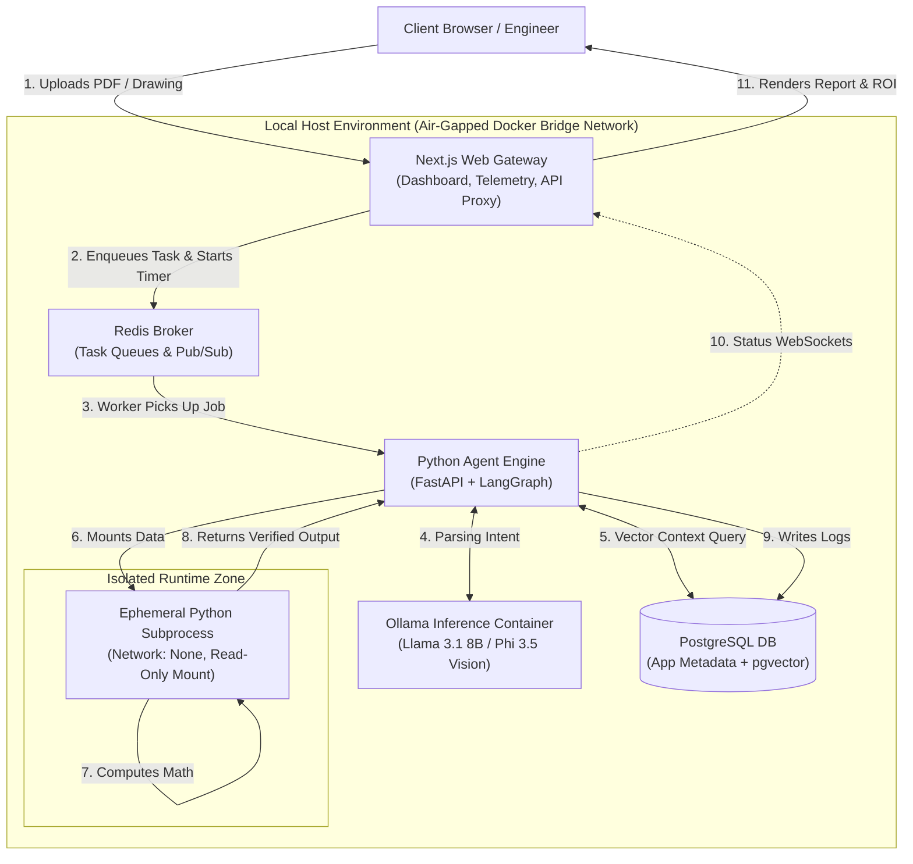

# Sovereign On-Premise Knowledge Workbench for Confidential Industrial Operations

Smart India Hackathon 2026 – Problem Statement SIH26117  
Host Organization: Mangalore Refinery and Petrochemicals Limited (MRPL)  
Nature of Project: Application Project  
Domain: Computer Science and Engineering  
Target Readiness: TRL 4 (Technology Validated in Lab)  

---

## Project Overview

Industrial organizations such as refineries, PSUs, and engineering firms handle high volumes of sensitive technical and operational data:
- Standard Operating Procedures (SOPs)
- Equipment inspection reports
- Plant technical calculations and spreadsheets
- Engineering drawings (P&IDs, schematics)
- Maintenance logs and internal records

Due to confidentiality requirements, this information cannot be transmitted to external, public cloud AI APIs.

The Sovereign On-Premise Knowledge Workbench is a private, self-contained AI system designed to run entirely on an organization's internal hardware without requiring internet connectivity. It assists engineers with routine, time-consuming tasks—including technical paper reviews, summary generation, approval note drafting, calculation verification, and spreadsheet updates—while keeping all data strictly within the organization's boundary.

---

## Key Features

1. Air-Gapped and Sovereign
   - Operates fully offline within a restricted local network.
   - Built-in network logging to verify zero external data transmission.

2. Multimodal Document Processing
   - Ingests text documents, scanned PDFs, tabular spreadsheets, and engineering drawings using open-weight vision-language models.

3. Agentic Workflow
   - Breaks complex user requests into discrete execution steps.
   - Selects appropriate local models, queries local documents, and runs deterministic validation tools.

4. Isolated Code and Calculation Sandbox
   - Executes Python calculations and data transformations in an isolated runtime environment with network disabled and read-only mounts.

5. Source Verification and Audit Logs
   - Cross-checks outputs against cited document sources and deterministic calculation results.
   - Maintains an immutable audit record for compliance and includes human approval for sensitive decisions.

6. Performance and ROI Tracking
   - Built-in timer monitors execution time to measure turnaround speed and productivity improvements compared to manual workflows.

---

## System Architecture

The workflow follows a local, air-gapped pipeline:



---

## Step-by-Step Processing Flow

| Step | Action | Description |
| :---: | :--- | :--- |
| 1 | Upload | Engineer uploads technical documents, scanned inspection reports, or drawings via the web dashboard. |
| 2 | Enqueue & Timer | Next.js enqueues the task into Redis and starts the automated processing timer. |
| 3 | Job Dispatch | The backend worker picks up the job and initializes the agent workflow. |
| 4 | Intent & Vision Analysis | Text analysis is handled by Llama 3.1 8B; diagram and drawing parsing is handled by Phi 3.5 Vision via Ollama. |
| 5 | Context Retrieval | Relevant document chunks are retrieved from PostgreSQL using pgvector similarity search. |
| 6 & 7 | Secure Calculation | Computations, data checks, or spreadsheet updates run inside an isolated Python sandbox with no network access. |
| 8 | Verification | The sandbox returns calculated results to the engine for verification against input parameters. |
| 9 | Audit Logging | Action history, intermediate outputs, and timestamps are saved to PostgreSQL. |
| 10 | Status Streaming | Real-time status and logs are streamed to the frontend via WebSockets. |
| 11 | Final Output | The UI renders the verified report, downloadable files, and time-saving metrics. |

---

## Repository Structure

```text
capstone/
├── client/                     # Next.js web dashboard
│   ├── app/                    # Application routes and components
│   ├── public/                 # Static assets
│   ├── package.json            # Node.js dependencies
│   └── tsconfig.json           # TypeScript configuration
│
├── server/                     # Python backend engine
│   ├── main.py                 # FastAPI application entrypoint
│   └── requirements.txt        # Python dependencies
│
├── docker-compose.yml          # Local container setup (PostgreSQL, Redis)
├── .gitignore                  # Git ignore rules
└── README.md                   # Project documentation
```

---

## Tech Stack

- Frontend: Next.js 15, React 19, TypeScript, Tailwind CSS
- Backend: Python 3.11+, FastAPI, LangGraph, Uvicorn
- Local Models: Ollama (Llama 3.1 8B, Phi 3.5 Vision, Nomic Embed Text)
- Storage & Queue: PostgreSQL 16 (with pgvector extension), Redis 7
- Sandbox: Ephemeral Python subprocess with restricted execution privileges
- Orchestration: Docker Compose

---

## Local Setup

### 1. Prerequisites
- Node.js (v20 or higher) and pnpm
- Python (v3.11 or higher)
- Docker Desktop
- Ollama

### 2. Pull Local AI Models
```bash
ollama pull llama3.1:8b
ollama pull phi3.5-vision
ollama pull nomic-embed-text
```

### 3. Start Database and Queue Services
```bash
docker-compose up -d
```

### 4. Run Frontend
```bash
cd client
pnpm install
pnpm dev
```
Access the dashboard at http://localhost:3000.

### 5. Run Backend
```bash
cd server
python -m venv venv
# Windows:
venv\Scripts\activate
# Linux/macOS:
# source venv/bin/activate

pip install -r requirements.txt
uvicorn main:app --reload --port 8000
```
Access the backend docs at http://localhost:8000/docs.

---

## Expected Outcomes

1. Validated Working Prototype: Tested locally on standard hardware using representative industrial and synthetic documents.
2. Comparative Evaluation Report: Documented benchmark comparing manual processing time versus automated workbench execution.
3. Technical Documentation: Complete architectural description and deployment guidelines for on-premise industrial use.

---

## Sustainable Development Goals (SDGs)

- SDG 8: Decent Work and Economic Growth – Automates repetitive paperwork to free engineering capacity for operational safety and analysis.
- SDG 9: Industry, Innovation and Infrastructure – Integrates private AI capabilities into core industrial workflows while safeguarding proprietary knowledge.
- SDG 16: Peace, Justice and Strong Institutions – Ensures complete data privacy, transparent source verification, and tamper-resistant audit trails.
